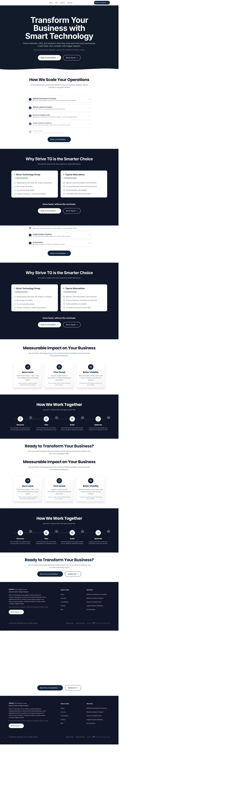
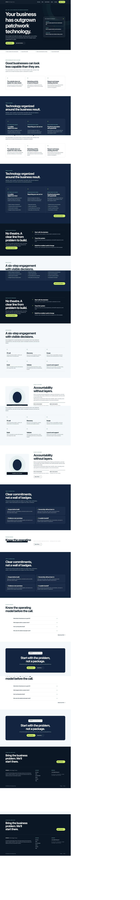
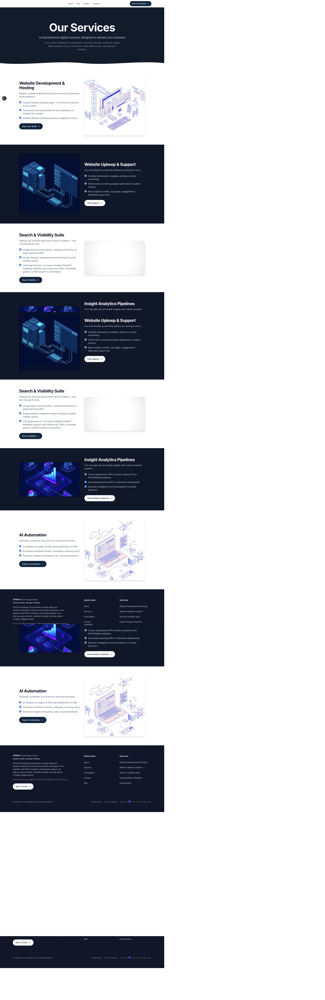
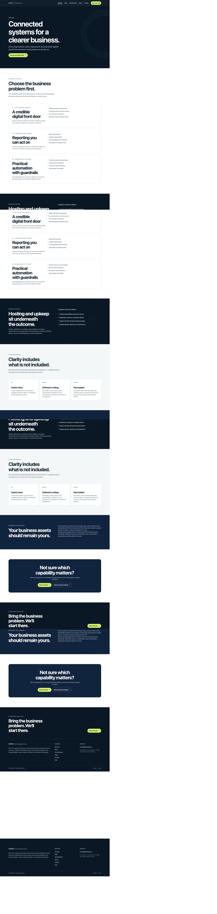
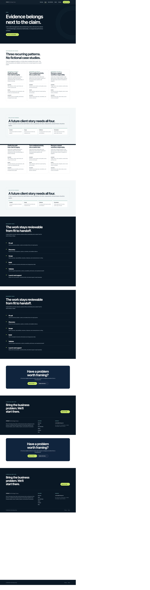
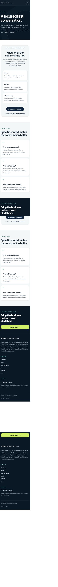

# Strive Technology Group Website Audit and Redesign Handoff

> **Historical implementation record:** This report describes the retired Calendly/public fit-call model. The current primary conversion path is the first-party project brief; public scheduling was removed, `/work` now redirects to `/approach`, and `/consultation` now redirects to `/start-a-project`. Founder-led marketing is also absent unless a complete approved founder package is supplied. Route names, architecture, screenshots, and verification counts below are August 31 snapshot evidence, not current release claims. Use `README.md`, `LEAD_INTAKE_SETUP.md`, `STRIVE_OFFER_AND_PRICING_STRATEGY.md`, and `OWNER_LAUNCH_DECISIONS.md` for current operating truth.

**Audit and implementation date:** August 31, 2026

**Working branch:** `feat/strive-credibility-redesign-20260831`

**Production changes:** none; nothing was pushed, merged, or deployed

**Engineering status:** implemented and verified locally

**Market-credibility status:** intentionally incomplete until owner evidence and legal review are supplied

This document is both the end-to-end repository audit and the implementation handoff. It describes what the website is, how it works, what changed, the evidence collected, and what still blocks an honest production launch.

## 1. Executive summary of the finished redesign

The repository now contains a focused, server-rendered marketing website for a founder-led technology partner serving growing service businesses. The redesign replaces a generic, claim-heavy agency presentation with a specific business narrative:

1. Help the right people find the business and convert.
2. Make reporting useful enough to guide decisions.
3. Remove repetitive work with practical automation and human guardrails.

The homepage now starts with the customer problem—outgrowing patchwork technology—and presents a fit call immediately. It then moves through truthful operating signals, recognizable business problems, the three service outcomes, a proof-ready problem-solving method, a six-step engagement model, a transparent founder-led operating model, concrete trust commitments, FAQ answers, and a focused close.

No clients, testimonials, logos, case studies, team members, awards, certifications, location, pricing, support commitments, performance results, or availability guarantees were invented. The `/work` page explains how evidence will be presented later without rendering fake proof now. The About page is candid about the founder-led model without inventing a founder name, biography, portrait, or internal team.

The engineering system was simplified at the same time:

- All nine public routes are statically rendered.
- Shared facts and claims are centralized to reduce contradictions.
- The five autoplay videos were removed and replaced by CSS-native visual systems.
- Global third-party font loading was removed in favor of a local system stack.
- Calendly is isolated behind an explicit click and is keyboard accessible.
- A nonfunctional first-party form was not introduced; direct email remains visible.
- SEO metadata, structured data, sitemap, robots rules, and a real 404 are present.
- Security headers and patched dependencies are in place.
- Playwright and Axe now enforce the primary release criteria.

This is engineering-complete, not credibility-complete. Owner identity, legal entity details, real proof, commercial facts, production data-handling facts, and counsel-approved legal text are still required before a full market-credibility sign-off.

## 2. Branch and commit list

**Branch:** `feat/strive-credibility-redesign-20260831`

The local review history is organized around these scopes:

1. `e28789d` — `feat(web): rebuild the credibility-focused site experience`
   - Route architecture, content, design system, responsive layout, logo treatment, Calendly behavior, SEO output, accessibility interactions, and removal of obsolete media/components.
2. `adaadb3` — `chore(web): remediate dependencies and add release gates`
   - Patched production dependencies, regenerated lockfile, security headers, lint modernization, Playwright/Axe tests, link checks, asset budget, and removal of the unused starter UI workspace.
3. `docs: add redesign audit, evidence, and release requirements` (the commit containing this report; use `git log` for its final hash)
   - Repository documentation, owner-content checklist, legal-review register, before/after screenshots, and all-route visual evidence.

Exact local hashes are available with:

```bash
git log --oneline --decorate -3
```

No commit was pushed or merged.

## 3. Complete changed-file inventory

### Product routes and application shell

- `apps/web/app/page.tsx` — rebuilt homepage and narrative order
- `apps/web/app/services/page.tsx` — outcome-led services, boundaries, support placement, and ownership model
- `apps/web/app/work/page.tsx` — new evidence-ready method page without fabricated case studies
- `apps/web/app/about/page.tsx` — transparent founder-led operating model
- `apps/web/app/faq/page.tsx` — consistent fit, pricing, ownership, support, measurement, AI, and handoff answers
- `apps/web/app/contact/page.tsx` — working email path and transparent explanation of why no form ships
- `apps/web/app/consultation/page.tsx` — fit-call expectations and click-to-load booking path
- `apps/web/app/privacy/page.tsx` — runtime-aligned working privacy draft
- `apps/web/app/terms/page.tsx` — ownership-aligned working terms draft
- `apps/web/app/layout.tsx` — one main landmark, skip link, metadata, shell, and Organization schema
- `apps/web/app/not-found.tsx` — correct custom 404 experience
- `apps/web/app/globals.css` — complete responsive token/component system, focus states, and reduced motion

### Shared components and facts

- `apps/web/app/lib/company.ts` — canonical company facts, navigation, service pillars, engagement steps, trust commitments, FAQ content, and public-route list
- `apps/web/app/components/Button.tsx` — one internal/external button-link implementation
- `apps/web/app/components/CalendlyDialog.tsx` — isolated accessible booking interaction
- `apps/web/app/components/Container.tsx` — layout primitive
- `apps/web/app/components/Footer.tsx` — truthful footer, navigation, email, legal links, and dynamic year
- `apps/web/app/components/Logo.tsx` — explicit light/dark-surface logo selection and corrected intrinsic dimensions
- `apps/web/app/components/Navigation.tsx` — compact accessible desktop/mobile navigation
- `apps/web/app/components/PageHero.tsx` — shared page heading pattern
- `apps/web/app/components/Section.tsx` — shared section primitive
- `apps/web/app/components/StructuredData.tsx` — safely serialized JSON-LD

### SEO and platform configuration

- `apps/web/app/opengraph-image.tsx` — generated branded sharing image
- `apps/web/app/robots.ts` — generated robots rules
- `apps/web/app/sitemap.ts` — generated sitemap for every public route
- `apps/web/next.config.js` — security headers, Content Security Policy, and framework disclosure removal

### Assets

- `apps/web/public/Full logo.svg` — preserved existing user modification as the dark-surface white logo
- `apps/web/public/Full logo on light.svg` — added separate navy logo for light surfaces
- Removed `AI Automation Animation.webm`
- Removed `Insights Analytics Animation.webm`
- Removed `Modern_Search_Engine_Animation.webm`
- Removed `Website Creation Animation.webm`
- Removed `Website Upkeep Animation.webm`

### Removed dead components

- `CTAStrip.tsx`
- `Card.tsx`
- `ComparisonSection.tsx`
- `FeatureCard.tsx`
- `MotionWrapper.tsx`
- `PremiumCompare.tsx`
- `ProcessTimeline.tsx`
- `ServicesDropdown.tsx`
- `ServicesPage.tsx`

### Dependencies, workspaces, and release gates

- `package.json` — Node floor, verification scripts, and patched transitive overrides
- `pnpm-lock.yaml` — safely regenerated dependency graph and stale importer removal
- `turbo.json` — test and asset-check pipeline support
- `apps/web/package.json` — patched runtime dependencies, removed unused UI/motion/icon libraries, modern scripts, and test tooling
- `apps/web/playwright.config.ts` — local production-server browser-test configuration
- `apps/web/tests/site.spec.ts` — routes, semantics, Axe, links, overflow, navigation, modal, Calendly, and reduced-motion coverage
- `apps/web/scripts/check-assets.mjs` — public-asset budget and prohibited-video enforcement
- `packages/eslint-config/base.js` — current ESLint configuration and ignores
- `packages/eslint-config/package.json` — lint package cleanup
- Removed the unused `packages/ui` package: its manifest, lint/TypeScript configuration, and three starter source files

### Documentation and evidence

- `README.md`
- `apps/web/README.md`
- `CONTENT_REQUIRED.md`
- `LEGAL_REVIEW_REQUIRED.md`
- `WEBSITE_AUDIT_AND_REDESIGN_REPORT.md`
- `docs/redesign/screenshots/before/*`
- `docs/redesign/screenshots/after/*`
- `docs/redesign/screenshots/visual-checks/*` — every route at 1440, 1024, 768, 390, and 375 pixels plus contact sheets

## 4. Before-and-after screenshots

### Homepage, desktop

Before:



After:



### Homepage, mobile

Before:


After:


### Services, desktop

Before:



After:



### New evidence-ready Work page



### Click-to-load booking page



Visual evidence also exists for all nine routes at all five required widths under `docs/redesign/screenshots/visual-checks/`. The human review inspected the top and bottom contact sheets for each width and the key full-page captures. That pass caught a mobile SVG intrinsic-ratio overflow that the automated geometry test did not expose; the logo dimensions and compact-header sizing were then corrected, rebuilt, and recaptured.

## 5. Before-and-after performance and asset measurements

| Measure                         |                   Before |                    After |                                                      Change |
| ------------------------------- | -----------------------: | -----------------------: | ----------------------------------------------------------: |
| Total `apps/web/public` payload |         18,038,059 bytes |             46,591 bytes |                           17,991,468 bytes removed (99.74%) |
| Five service WebM files         |         18,011,568 bytes |                  0 bytes |                                            Removed entirely |
| Public files                    |                        8 |                        4 | Only two full-logo variants, short logo, and favicon remain |
| Production route first-load JS  | approximately 102–143 kB | approximately 102–111 kB |                           Peak reduced by about 32 kB (22%) |
| Third-party font request        |      Google-hosted fonts |                     none |                                     System/local font stack |
| Calendly loading                |    global/eager behavior |     click-to-load iframe |                         No booking connection before intent |

The replacement visuals are CSS-native diagrams/cards and static SVG brand assets. There is no autoplay media, audio, animation library, icon library, or large decorative bitmap. The asset gate caps the public directory and rejects video extensions so this regression is testable.

These are build and repository measurements, not field Core Web Vitals or Lighthouse claims. Production performance must still be measured on the deployed origin and representative devices.

## 6. Security-audit results

### Baseline

The original production dependency audit reported 33 known advisories:

- 1 critical
- 16 high
- 14 moderate
- 2 low

The application was on a vulnerable Next.js maintenance line. The remediation followed the official [Next.js August 2026 security release](https://nextjs.org/blog/august-2026-security-release) and upgraded within Next 15 rather than introducing an unnecessary framework-major migration.

### Remediation

- Next.js: `15.5.24`
- React / React DOM: `19.1.9`
- PostCSS: `8.5.26`
- pnpm overrides: `nanoid@3.3.18`, `postcss@8.5.26`, and `sharp@0.35.4`
- Node engine floor: `>=20.9.0`
- Stale workspace importer removed from the lockfile
- Unused runtime dependencies and starter workspace removed

### Result

`pnpm audit --prod` reports **no known vulnerabilities**. No advisories were suppressed.

Security response headers now include a scoped Content Security Policy, `X-Content-Type-Options`, `Referrer-Policy`, `Permissions-Policy`, frame restrictions, and related hardening compatible with the actual Calendly iframe. Next.js's identifying response header is disabled.

HSTS is not configured yet because the production hostname and subdomain HTTPS posture were not verified. That is a deployment decision, not an omitted checkbox. This work is dependency and browser-policy hardening; it is not a penetration test or compliance certification.

## 7. Build, lint, test, accessibility, and link-check results

| Gate                        | Result                                                                                      |
| --------------------------- | ------------------------------------------------------------------------------------------- |
| ESLint                      | Passed with 0 warnings and 0 errors                                                         |
| TypeScript                  | Passed with no emit                                                                         |
| Next.js production build    | Passed; all public routes statically generated                                              |
| Public asset budget         | Passed at 46,591 bytes; no WebM/MP4 assets                                                  |
| Production dependency audit | Passed; no known vulnerabilities                                                            |
| Playwright                  | Historical August 31 snapshot: 24 tests passed                                              |
| Route smoke tests           | All 9 public routes plus custom 404 passed                                                  |
| Internal links              | Every discovered internal link resolved                                                     |
| Axe                         | No serious or critical violations across all 9 routes                                       |
| Landmarks/headings          | One main landmark and one H1 on every public route                                          |
| Horizontal overflow         | None at 1440, 1024, 768, 390, or 375 pixels                                                 |
| Mobile navigation           | Keyboard/button state, Escape close, and focus restoration passed                           |
| Calendly modal              | Click-to-load, accessible naming, focus trap, Escape, restoration, and success event passed |
| Reduced motion              | No autoplay media; reduced-motion behavior passed                                           |
| Human visual inspection     | All 45 route/width combinations reviewed and retained                                       |

The automated Axe result is a valuable baseline, not a claim of full WCAG 2.1 AA conformance. Manual assistive-technology, zoom/reflow, production content, and user testing remain appropriate before making a compliance statement.

The build emits a non-blocking browsers-data freshness notice for local development tooling. It does not change runtime dependencies or invalidate the passing production build, but the database can be refreshed during routine tooling maintenance.

## 8. Claims removed or rewritten

The original site contained or implied material claims that were not supported by repository evidence. The redesign removed or replaced them as follows:

| Original claim or implication                      | Resolution                                                                          |
| -------------------------------------------------- | ----------------------------------------------------------------------------------- |
| “3–5x more leads”                                  | Removed; no conversion result is stated without a baseline and measurement evidence |
| “10+ hours saved weekly”                           | Removed; automation is described by workflow and guardrails, not universal savings  |
| “60–70% savings”                                   | Removed                                                                             |
| “ROI within 90 days”                               | Removed                                                                             |
| “24/7 support” or monitoring                       | Removed; support hours and monitoring must be approved and scoped                   |
| 24-hour response promise                           | Removed; contact explicitly avoids an unverified response-time commitment           |
| “Proven track record”                              | Removed                                                                             |
| “Successful businesses” as implied proof           | Removed                                                                             |
| “Enterprise-grade” outcomes/guarantees             | Removed                                                                             |
| Universal delivery timeline such as 2–4 weeks      | Removed; timing is established in written scope                                     |
| Anonymous “Meet Our Team” presentation             | Replaced with accurate founder-led language and no invented people                  |
| Unverified Boston/local-business signal            | Omitted pending owner approval                                                      |
| Fake/placeholder client work                       | Not rendered; `/work` explains the evidence standard and method                     |
| Universal pricing                                  | Replaced with a transparent explanation of how estimates are produced               |
| Broad “AI can automate anything” framing           | Replaced with focused workflow discovery, risk boundaries, and human review         |
| Conflicting ownership language                     | Replaced with one consistent paid-deliverable/background-IP/support model           |
| Implied final legal policies                       | Pages are visibly labeled working drafts requiring professional review              |
| Implied WCAG/Lighthouse/Core Web Vitals compliance | Removed; only actual test evidence is reported                                      |

The revised copy also avoids fake urgency, empty enterprise language, unverified logos/badges, and promises that depend on client operations, market conditions, traffic, or third-party systems.

## 9. Remaining factual content needed from the owner

The detailed evidence register is in [`CONTENT_REQUIRED.md`](CONTENT_REQUIRED.md). The high-priority inputs are:

1. Founder name, title, approved biography, headshot, and professional links.
2. Confirmation that founder-led language and any specialist/contractor wording are accurate.
3. Legal entity name/type/jurisdiction, approved address, service area, phone, and canonical domain behavior.
4. Verified ownership and monitoring of the contact inbox and Calendly event.
5. Permissioned client names, logos, testimonials, and complete case-study evidence packages.
6. Approved metrics with baseline, period, source, measurement method, and attribution limits.
7. Pricing ranges, fit-call terms, delivery ranges, billing/cancellation rules, and support/service boundaries.
8. Support hours, response commitments, escalation, backups, monitoring, restoration, and offboarding procedures.
9. Technologies/platforms Strive actually supports.
10. Production hosting, email, logging, retention, privacy, analytics, CRM, and processor facts.
11. Approved company/social profiles for structured data.

Until these exist, the site should keep founder identity, social proof, pricing, location, phone, guarantees, and external-profile schema absent.

## 10. Legal items requiring professional review

The full decision register is in [`LEGAL_REVIEW_REQUIRED.md`](LEGAL_REVIEW_REQUIRED.md). Counsel and the owner must review:

- Legal entity identity, notice address, governing law, venue, disputes, and effective-date mechanics
- Applicable privacy jurisdictions, lawful bases/consent, rights, retention, deletion, request verification, processors, transfers, logs, and future cookies/analytics
- Proposal precedence, contract formation, fees, taxes, deposits, refunds, late payment, changes, acceptance, delay, renewal, cancellation, and suspension
- Hosting, monitoring, backup, incident, support, export, transition, and post-termination obligations
- Definitions and licensing for client materials, custom work, Strive background IP, reusable systems, third-party software, and separately licensed products
- Confidentiality, publicity, case-study permission, warranties, disclaimers, liability, indemnities, accessibility, performance, SEO, security, and result claims

The public `/privacy` and `/terms` content matches the currently implemented website more closely than the previous text, but it remains a working draft. It must not substitute for a project-specific agreement.

## 11. Deployment checklist

### Owner and legal approval

- [ ] Resolve the launch-critical items in `CONTENT_REQUIRED.md`.
- [ ] Have qualified counsel approve `/privacy`, `/terms`, and the decisions in `LEGAL_REVIEW_REQUIRED.md`.
- [ ] Historical checklist superseded: the current working decision keeps `https://www.strivetg.com` canonical and redirects the apex host to `www` only after DNS, SSL, and ownership checks.
- [ ] Confirm the legal business identity and approved public contact details.
- [ ] Confirm the contact inbox and Calendly event are active, controlled, monitored, and correctly configured.

### Release verification

- [ ] Review the final diff and local commit history.
- [ ] Install with `pnpm install --frozen-lockfile` on Node 20.9 or newer.
- [ ] Run `pnpm verify` on the exact release commit.
- [ ] Deploy to a preview environment first.
- [ ] Recheck all nine routes, the custom 404, mobile menu, email links, Calendly success path, long legal copy, logos, footer, and CTA visibility.
- [ ] Check keyboard order, focus visibility, zoom/reflow, reduced motion, and at least one screen-reader flow manually.
- [ ] Validate `/sitemap.xml`, `/robots.txt`, canonical tags, Open Graph output, Twitter metadata, and JSON-LD on the deployed origin.
- [ ] Confirm CSP and other security headers from the deployed response.
- [ ] Add HSTS only after HTTPS is confirmed for the intended hostname/subdomain policy.
- [ ] Measure real production Core Web Vitals and fix regressions before publishing a score or claim.

### Content governance after launch

- [ ] Require evidence and permission before adding any testimonial, client logo, case study, metric, certification, award, profile, or location.
- [ ] Re-run tests and visual checks after substantive content/legal changes.
- [ ] Schedule dependency and production-audit maintenance.
- [ ] Re-review privacy text whenever analytics, monitoring, CRM, form, advertising, or scheduling behavior changes.

## 12. Release-state confirmation

Nothing in this mission was pushed, merged, deployed, published, purchased, or connected to an external account. All work remains local on `feat/strive-credibility-redesign-20260831`.

The website's **engineering implementation is complete and locally verified**. Its **market-credibility and legal readiness are not complete** until the owner provides the documented facts/evidence and qualified counsel approves the working policy drafts. That distinction is intentional and should remain visible in any release decision.

## Appendix A: End-to-end runtime architecture

```text
Visitor request
  -> Next.js App Router
     -> root layout: metadata, navigation, one <main>, footer, Organization JSON-LD
     -> statically generated route content
        -> centralized company/service/FAQ facts
        -> route metadata + canonical
        -> optional route JSON-LD (Service or FAQ)
     -> browser receives semantic HTML + shared CSS
        -> navigation JS only for compact menu behavior
        -> Calendly JS only after the visitor clicks “Open booking calendar”
           -> iframe restricted to approved Calendly origins
           -> validated completion message updates accessible success state
        -> direct email remains available without Calendly
```

There is no application database or server-side lead pipeline. Operational lead handling happens in the owner's email and Calendly accounts and therefore must be verified outside this repository before launch.

## Appendix B: Public route map

| Route           | Purpose                                                                                   | Structured/SEO behavior                                     |
| --------------- | ----------------------------------------------------------------------------------------- | ----------------------------------------------------------- |
| `/`             | Positioning, problems, outcomes, method, engagement, founder model, commitments, FAQ, CTA | Unique metadata, canonical, Organization schema inherited   |
| `/services`     | Three outcome pillars, boundaries, support placement, ownership                           | Unique metadata, canonical, Service schema                  |
| `/work`         | Problem-solving patterns and evidence standard                                            | Unique metadata, canonical; no fabricated case-study schema |
| `/about`        | Founder-led model and operating principles                                                | Unique metadata and canonical                               |
| `/faq`          | Fit, scope, pricing, ownership, support, measurement, AI, handoff                         | Unique metadata, canonical, visible-content FAQ schema      |
| `/contact`      | Direct email and fit-call options                                                         | Unique contact metadata and canonical                       |
| `/consultation` | Booking expectations and click-to-load scheduler                                          | Unique consultation metadata and canonical                  |
| `/privacy`      | Working runtime-aligned privacy disclosure                                                | Unique metadata and canonical; legal-review notice          |
| `/terms`        | Working engagement/ownership terms                                                        | Unique metadata and canonical; legal-review notice          |
| unmatched route | Helpful custom not-found response                                                         | Correct 404 status                                          |

## Appendix C: Visual verification matrix

Every cell below was rendered as a full-page screenshot and visually inspected.

| Route           | 1440 | 1024 | 768 | 390 | 375 |
| --------------- | :--: | :--: | :-: | :-: | :-: |
| `/`             |  ✓   |  ✓   |  ✓  |  ✓  |  ✓  |
| `/services`     |  ✓   |  ✓   |  ✓  |  ✓  |  ✓  |
| `/work`         |  ✓   |  ✓   |  ✓  |  ✓  |  ✓  |
| `/about`        |  ✓   |  ✓   |  ✓  |  ✓  |  ✓  |
| `/faq`          |  ✓   |  ✓   |  ✓  |  ✓  |  ✓  |
| `/contact`      |  ✓   |  ✓   |  ✓  |  ✓  |  ✓  |
| `/consultation` |  ✓   |  ✓   |  ✓  |  ✓  |  ✓  |
| `/privacy`      |  ✓   |  ✓   |  ✓  |  ✓  |  ✓  |
| `/terms`        |  ✓   |  ✓   |  ✓  |  ✓  |  ✓  |
